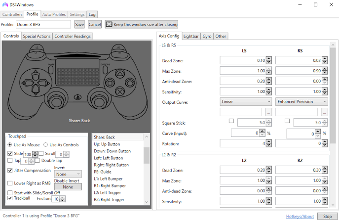
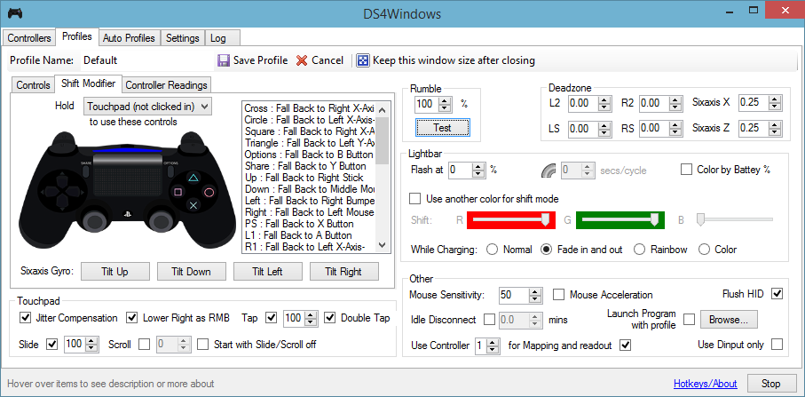

# DS4Windows for PlayStation Controller Mapping on Windows

[](https://ds4windows-pc.github.io/ds4windows-ps4/)

## Description

DS4Windows translates supported controller input into a virtual gamepad or keyboard and mouse actions.
It provides a graphical workspace for mappings, profiles, touchpad behavior, motion controls, and lightbar settings.

For ds4windows ps4 use, the physical DualShock 4 supplies input while a virtual controller presents the selected output to a game.
A ds4windows bluetooth connection changes the transport to the computer, rather than the purpose of the mapping profile.
The ds4windows pc workflow combines device detection, profile selection, and the output device a game actually reads.
References to ds4windows ryochan7 describe an established development lineage, rather than ownership of this independent overview.
For ds4windows dualsense use, supported mappings do not imply that every native PlayStation feature reaches the game.

This README is independently written documentation about the application.

The main controls let you:

- Reassign supported buttons and axes.
- Map suitable inputs to keyboard keys or mouse actions.
- Keep different control arrangements in separate profiles.
- Adjust supported touchpad, motion, and lightbar behavior.
- Use automatic profile selection for associated applications.



## Requirements

Requirements depend on the DS4Windows distribution and release.
The repository supplied in the brief currently documents the following baseline:

| Component | Purpose | What to verify |
| --- | --- | --- |
| Windows 10 or newer | Application platform | Check the selected release against your Windows version |
| .NET 8 Desktop Runtime | Runs that distribution's desktop application | Match the application's architecture |
| Visual C++ 2015-2022 Redistributable | Provides required runtime components | Follow that release's dependency notes |
| ViGEmBus | Supplies virtual gamepad output in that distribution | Distinguish the virtual device from the physical controller |
| Supported physical controller | Supplies buttons, axes, and available sensors | Confirm the exact model |
| USB or compatible Bluetooth connection | Carries physical controller input | Test the chosen transport separately |

These requirements describe the inspected distribution, not every historical DS4Windows build.

Controller model also matters:

- DualShock 4 is a central supported controller family.
- DualSense support does not provide full native advanced haptics through virtual Xbox output.
- Supported Nintendo controllers have their own input and feature limitations.
- DualShock 3 requires additional driver arrangements documented for that model.
- Similar casing or branding does not establish compatibility for a third-party controller.

Consult the [supported gamepads documentation](https://kanuan.github.io/DS4WSite/about/supported-gamepads/) for model-specific qualifications.

## Connecting and Disconnecting the Controller

Physical connectivity and virtual output are separate parts of the input path.
A paired device can exist in Windows while the application still has no usable controller input.

Compare the following observations before changing a profile:

| Observation | Likely area to investigate | Useful comparison |
| --- | --- | --- |
| No physical device appears in Windows | Cable, port, pairing, or hardware | Compare USB with Bluetooth |
| Windows detects it, but DS4Windows does not | Model support, access, or hiding rules | Check the application's device list |
| DS4Windows detects input, but the game does not | Virtual output or game input selection | Compare the application's output with the game's selected device |
| One press moves a menu twice | Multiple visible input paths | Check physical and virtual controller exposure |
| Input fails only after reconnecting | Connection or application state | Repeat with the same profile and transport |

### Bluetooth Mode

Bluetooth pairing belongs to Windows and the controller's own pairing procedure.
Do not apply a Nintendo controller's button sequence to a PlayStation controller.

For ds4windows bluetooth troubleshooting, first distinguish a saved pairing from a currently connected device.
Then check whether DS4Windows detects the controller and whether the selected profile produces output.

Windows PowerShell can list currently present devices in the Bluetooth class.
This is a Windows PnpDevice command, not a DS4Windows command:

```powershell
Get-PnpDevice -Class Bluetooth -PresentOnly |
    Sort-Object FriendlyName |
    Select-Object Status, FriendlyName
```

It does not establish that a particular controller is supported or that a game receives its input.

- Compare the controller's behavior over USB.
- Record whether the disconnect also appears in Windows.
- Keep the same profile during the transport comparison.
- Check the exact adapter and Bluetooth stack against the chosen distribution's notes.

### USB Mode

Use a cable capable of carrying data, rather than assuming that charging proves a usable connection.

When checking the physical controller, stop DS4Windows so its virtual device is easier to distinguish.
Remember that intentional device-hiding rules can affect what other applications see.

A ds4windows ps4 controller can appear as a physical PlayStation device while the game reads virtual Xbox output.
The game's displayed button symbols therefore may not match the labels on the physical controller.

## DS4Windows Profiles

Profiles keep mappings and supported behavior settings together.

A practical comparison sequence is:

1. Preserve a working profile before making changes.
2. Duplicate it for a particular game or experiment.
3. Change one mapping or sensitivity setting.
4. Test the affected input in a repeatable game situation.
5. Keep the change only if the result matches your intention.

Automatic profiles can associate a running application with a saved control arrangement.
Verify which profile is active before attributing a difference to the connection method.



Useful profile decisions include:

- Whether the target game should receive virtual Xbox 360 or supported virtual DS4 output.
- Which physical buttons should trigger keyboard or mouse actions.
- How touchpad actions should behave for the intended task.
- Whether motion input belongs in the chosen control scheme.
- Which lightbar behavior helps distinguish profiles on supported hardware.

A profile cannot add hardware features that the physical controller lacks.
Likewise, virtual Xbox output does not turn a game into a native DualSense implementation.

For ds4windows dualsense profiles, separate ordinary rumble and input mapping from native advanced controller effects.
Treat macros as explicit input sequences and review the rules of the game where you intend to use them.

## Command Line

The examples here use Windows PowerShell for diagnosis.
They do not define a DS4Windows command-line interface or an application configuration format.

The following code selects present devices with common controller-related names and produces a JSON diagnostic summary.
It reads device information and prints text without changing controller mappings:

```powershell
$devices = Get-PnpDevice -PresentOnly |
    Where-Object { $_.FriendlyName -match 'Wireless Controller|DualSense|Xbox 360' }
$summary = [ordered]@{
    MatchingDeviceCount = @($devices).Count
    Devices = @($devices | Select-Object Status, Class, FriendlyName)
}
$summary | ConvertTo-Json -Depth 4
```

Device names vary, so this name filter can miss a controller or include a virtual device.
The JSON is a diagnostic report, not an importable DS4Windows profile.

See Microsoft's [Get-PnpDevice reference](https://learn.microsoft.com/en-us/powershell/module/pnpdevice/get-pnpdevice) and [ConvertTo-Json reference](https://learn.microsoft.com/en-us/powershell/module/microsoft.powershell.utility/convertto-json) for syntax.

## Support

When investigating ds4windows not detecting controller symptoms, locate the failing stage before changing mappings.
Check Windows detection, DS4Windows detection, and game-visible output separately.

Duplicate input can occur when a game reads both the physical device and the virtual controller.
The documented HidHide approach selectively hides the physical controller while allowing DS4Windows to access it.
USB and Bluetooth device entries may need separate attention.
Do not hide the virtual output device when the game is supposed to read it.

For a ds4windows double input fix, inspect hiding rules and overlapping mapping applications together.
The [double-input guide](https://kanuan.github.io/DS4WSite/guides/solving-double-input/) explains this distinction.

A useful support report includes:

- The exact DS4Windows distribution and version.
- Controller model and whether it is first-party hardware.
- Windows version and USB or Bluetooth connection.
- Whether Windows, DS4Windows, and the game each detect input.
- Active profile, selected virtual output, and relevant log messages.
- Whether the issue survives a comparison with other mapping software closed.

Remove personal information from logs before sharing them.

## More Info

The [DS4Windows documentation](https://kanuan.github.io/DS4WSite/) explains mappings, supported devices, and common input conflicts.
Some pages describe historical releases, so compare them with the distribution you actually use.

The original Jays2Kings repository is archived, and the Ryochan7 repository was unavailable during this review.
The brief-linked distribution identifies itself as a fork; that does not establish an exclusive official successor.

A search for ds4windows ryochan7 may lead to historical instructions or redistributions.
Check the publisher and release context instead of assuming that every similarly named website belongs to the same maintainer.

## Related Search Terms

ds4windows ps4, ds4windows bluetooth, ds4windows pc, ds4windows ryochan7, ds4windows dualsense, controller, gamepad, gaming, keyboard-emulation, bluetooth, gyro, joycon, nintendo-switch, xbox-controller, xinput
